<p align="center">
  
</p>

<h1 align="center">Magic Mend</h1>

<p align="center">
  <strong>Select. Press a hotkey. Click Replace. Your words, mended.</strong>
</p>

<p align="center">
  <a href="https://github.com/mahatab/magic-mend/releases/latest"></a>
  
  
  
  
  
  
  
  <a href="LICENSE"></a>
</p>

---

Magic Mend is a small tray app for **Windows and macOS** that rewrites the text you select, in any app, into a clear and human message. Select a message in WhatsApp, Outlook, LinkedIn, a browser, or anywhere else, press **Ctrl+Alt+R** (**Ctrl+Option+R** on a Mac), pick a tone in a calm popup, and click **Replace**. The new text drops right back where the old text was.

It runs on **your own Claude or ChatGPT login** through each service's official command (`claude` for Claude, OpenAI's `codex` for ChatGPT), so there is no account, no extra subscription, and no server in between. Have both? Pick one in setup and switch from the tray any time.

> [!IMPORTANT]
> **Magic Mend never sends a message for you.** Replace only puts the text in the box. You read it and press Send yourself. The only keys Magic Mend ever sends to another app are the copy and paste shortcuts.

Rephrasing used to take six steps: open Claude, start a chat, paste, ask, copy, paste back. Magic Mend makes it three.

## How It Works

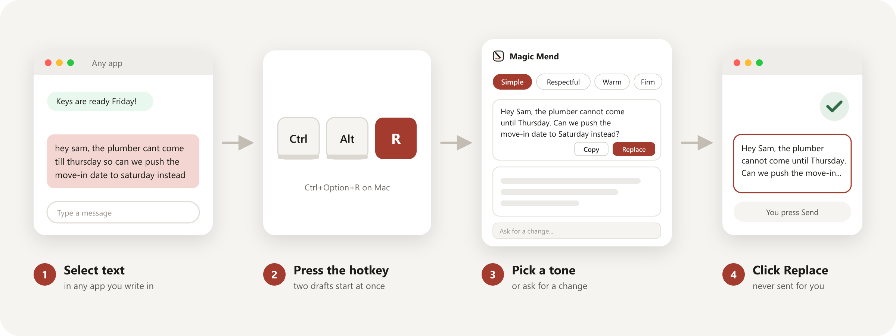

You select text and press the hotkey. Magic Mend copies the selection (and puts your clipboard back right after), opens the popup on the same screen, and starts **two drafts at once** from a Claude or ChatGPT process that is already warm and waiting. Change the tone, the length, or the channel and the drafts redo themselves. Type a change like *"remove the apology"* and only that changes. When a draft looks right, click **Replace**: Magic Mend returns to the original window, pastes, and restores your clipboard again.

## Download

<p>
  <a href="https://github.com/mahatab/magic-mend/releases/download/v1.1.0/Magic.Mend_1.1.0_x64-setup.exe"></a>
  &nbsp;
  <a href="https://github.com/mahatab/magic-mend/releases/download/v1.1.0/Magic.Mend_1.1.0_universal.dmg"></a>
</p>

| | |
| --- | --- |
| **Windows** | Windows 10 or 11, 64-bit. Installs for your user only (no admin prompt) and starts at login. |
| **macOS** | macOS 11 or later, Apple silicon and Intel. Open the `.dmg` and drag Magic Mend to Applications. Signed with a Developer ID and notarized by Apple, so it opens like any other app. |
| **You also need** | Claude, ChatGPT, or both:<br>**Claude**: [Claude Code](https://claude.com/product/claude-code), signed in once with `claude auth login`.<br>**ChatGPT**: the [Codex app](https://openai.com/codex), the ChatGPT extension for VS Code, or `npm i -g @openai/codex`, signed in once with `codex login`. |

The first launch opens a short setup wizard. It finds `claude` and `codex`, checks that each is signed in, sends one tiny test rewrite through each, lets you choose which one writes your drafts, lets you choose a hotkey and your default tone, and ends with a practice box where you try the whole thing. It takes under two minutes.

## Features

### Claude or ChatGPT 
- **Works with either service**, through its official command on your own login: `claude` (Claude Code) or OpenAI's `codex` (from the Codex app, the ChatGPT extension, or npm)
- **Have both?** The setup wizard detects both, tests each with a live rewrite, and lets you choose. Switch any time from the tray menu (**Rewrite with Claude** / **Rewrite with ChatGPT**) or Settings
- **The popup shows who is writing**, with a small Claude or ChatGPT badge next to the name
- **Same rules for both**: no contractions, no em dashes, facts kept, never sends, isolated from your personal setup
- **Pick the model** for each service in Settings. ChatGPT models are listed live from your plan

### One Hotkey, Three Steps
- **Works in any app** where you can select text: chat apps, email, browsers, documents, forms
- **Popup on the same screen** as the window you are writing in, ready the moment the hotkey is released
- **Two drafts start immediately** with your default tone. No clicking, no questions first
- **Replace** pastes the draft back into the original text box. **Copy** keeps it on the clipboard instead

### Tones, Lengths, and Toggles
- **Six tones**: Simple (default), Respectful, Warm, Casual, Professional, Firm
- **Three lengths**: Shorter, Same (default), Fuller
- **Fix errors only** : corrects spelling, grammar, and word slips while keeping your own words, and returns one draft
- **Softer** turns demands into suggestions (*"you can adjust"* instead of *"adjust"*)
- **Less thankful** keeps at most one thank-you and one apology
- Every chip change redoes the drafts, and five quick clicks still send just one request

### Follow-Ups That Edit Word by Word
- Type a change in the popup, such as *"remove the apology"* or *"make the second sentence shorter"*, and press Enter
- Follow-ups continue the same conversation, so the rest of the draft stays as it was
- Chain as many as you like before you click Replace

### Channel Aware
- **Detected from the active app**, with a one-click override
- **Text and WhatsApp**: no subject, no sign-off, a greeting only if you wrote one
- **Email**: a short greeting, a sign-off like *"Best,"*, and a **subject line** with its own Copy button. Replace pastes the body only
- **LinkedIn**: slightly more professional, no emojis, short paragraphs
- Detection rules (process names and window titles) are editable in Settings

### Output You Can Trust
- **Sounds like a person**: plain words, no corporate filler
- **No contractions and no em dashes**, ever. Every draft is scanned (straight and curly apostrophes included). If one slips through, Claude or ChatGPT is asked once to fix it, and any leftover em dash is fixed locally. Replace and Copy stay off until a draft passes
- **Facts kept exactly**: names, numbers, dates, times, prices, links, and addresses
- **Greetings and special phrases kept as written**, in any language, such as *"Good morning everyone!"*
- **Never invents** facts, promises, or names, and keeps your first person voice

### Safe by Design
- **Never sends.** No Enter, no Send button, no submit. Pasted text never ends with a line break, because some apps treat that like Enter
- **Replace and Copy are mouse only.** No keyboard shortcut can trigger them, not even Enter on a focused button
- **Enter stays in the popup.** In the change box, Enter submits the change inside Magic Mend. Shift+Enter adds a line
- **Your clipboard is protected.** Every format is saved before an internal copy or paste and restored after, including images and rich text. Temporary values are hidden from clipboard history
- **Smart about where it pastes.** The header always names the target app. If you click back into it, Replace becomes **Paste at cursor**. If the window closes, Replace becomes **Copy only**
- **Stays out of risky apps.** The hotkey does nothing in terminals, password managers, and remote desktop clients (editable list)
- **Administrator apps** ignore keys from normal apps, so Magic Mend says so and Copy still works

### Private by Default
- Your text goes **only** to the command you chose on your computer (`claude` or `codex`), which sends it to Anthropic or OpenAI under your own plan
- **No telemetry, no accounts, no analytics, no network connections** of its own. The popup even blocks every web request through its content security policy
- Messages and drafts live **in memory only**. The log holds error types and timings, never text
- Magic Mend **never reads your Claude or ChatGPT login**. It checks sign-in with `claude auth status` or `codex login status`, which report only yes or no

### Fast, Thanks to a Warm Engine
- One `claude` or `codex` process **waits in the background**, so the hotkey skips the start-up delay
- After Replace, Copy, or close, that process ends and a fresh one starts: **every message begins with a clean context**
- Recycled after 6 idle hours and after the computer wakes from sleep
- **Popup visible in under 0.1 s, even while you still hold the keys. First words in about 1.2 s. Finished drafts in about 1.6 s.** (Measured below)

### Polished Details
- **Light and dark** themes that follow your system, with a translucent acrylic background on Windows 11 and vibrancy on macOS
- **Streaming drafts** that fade in word by word, with plain placeholder lines that fade slowly while the first words are on their way
- **Reduced motion** respected everywhere
- **Accessible**: WCAG AA contrast, visible focus rings, screen reader labels on every control, zero axe-core violations
- **Plain error messages** that name the service and the fix: command missing, signed out, plan limit reached, offline, model not on your plan, or a 30 second timeout with Retry

## Screenshots

<p align="center">
  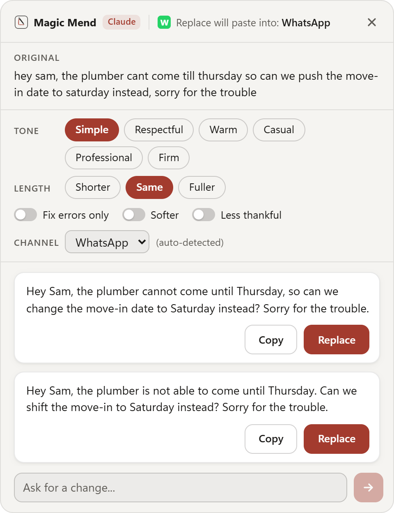
  &nbsp;&nbsp;
  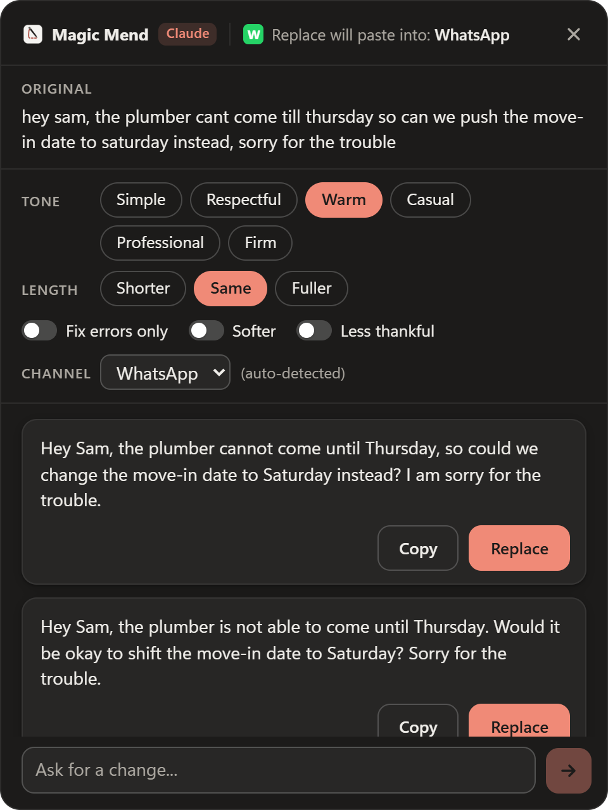
</p>
<p align="center"><em>Two real drafts in light and dark. The header always shows where Replace will paste.</em></p>

<p align="center">
  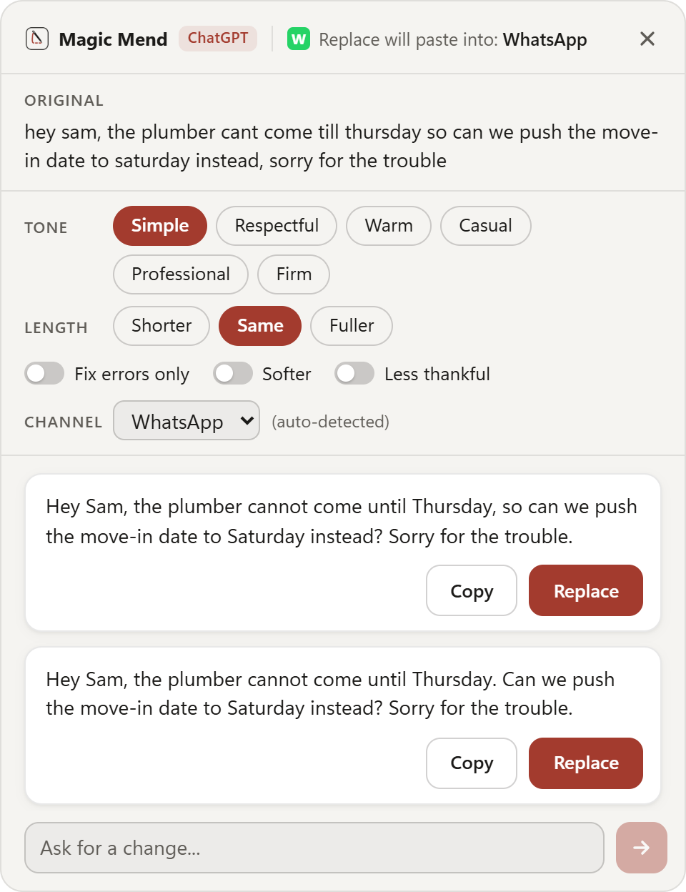
  &nbsp;&nbsp;
  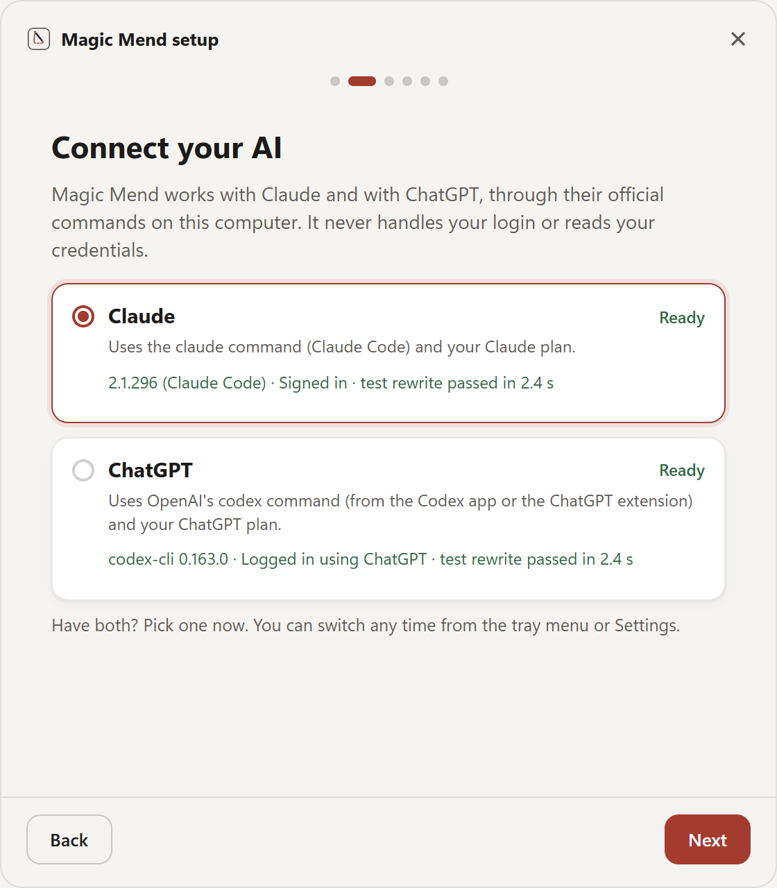
</p>
<p align="center"><em>The same popup with ChatGPT writing (real GPT-6-Luna drafts). Setup detects Claude and ChatGPT and lets you choose.</em></p>

<p align="center">
  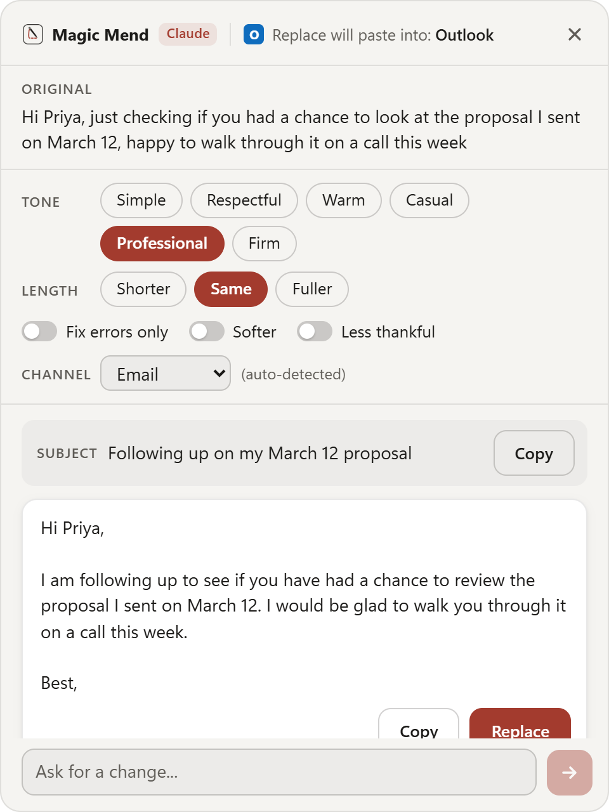
  &nbsp;&nbsp;
  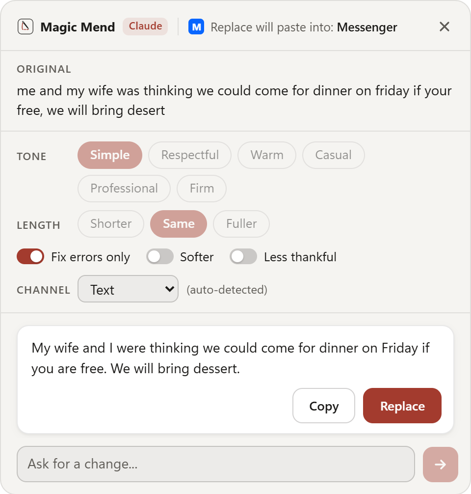
</p>
<p align="center"><em>Email adds a greeting, a sign-off, and a subject line. Fix errors only keeps your words and fixes the mistakes.</em></p>

<p align="center">
  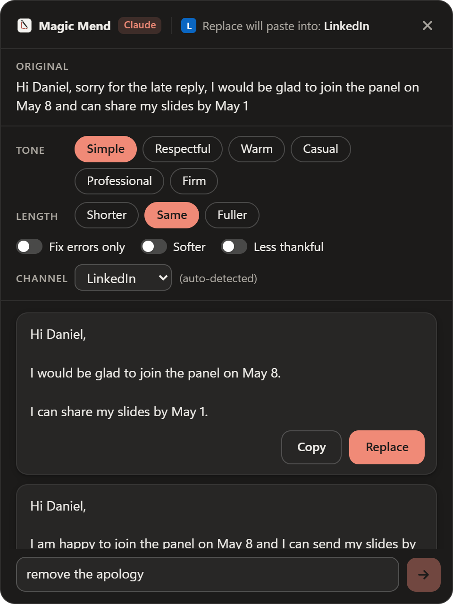
  &nbsp;&nbsp;
  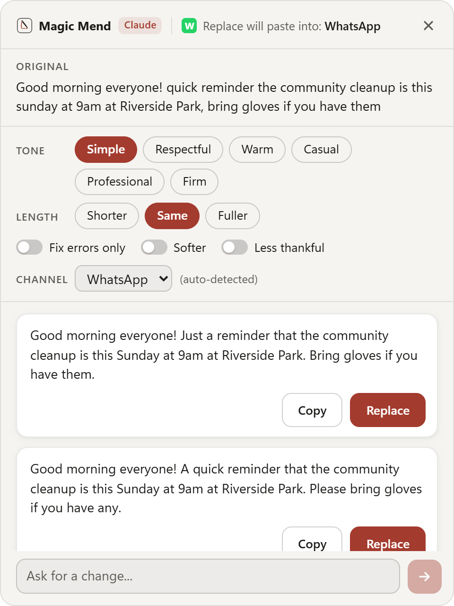
</p>
<p align="center"><em>"Remove the apology" changes only that. Greetings, days, times, and places are kept exactly as written.</em></p>

<p align="center">
  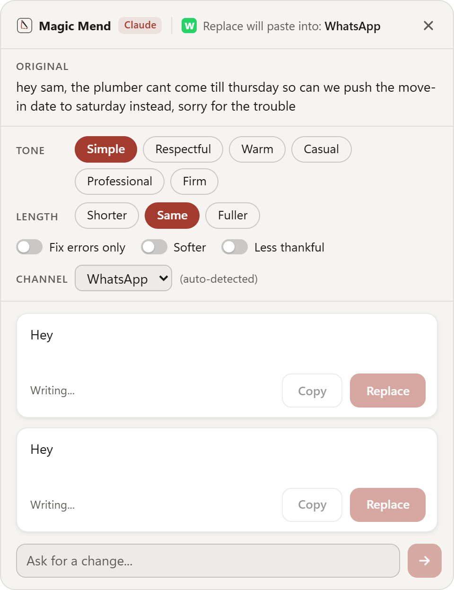
</p>
<p align="center"><em>Drafts stream in as Claude or ChatGPT writes them. Replace and Copy turn on once a draft passes the output check.</em></p>

<p align="center">
  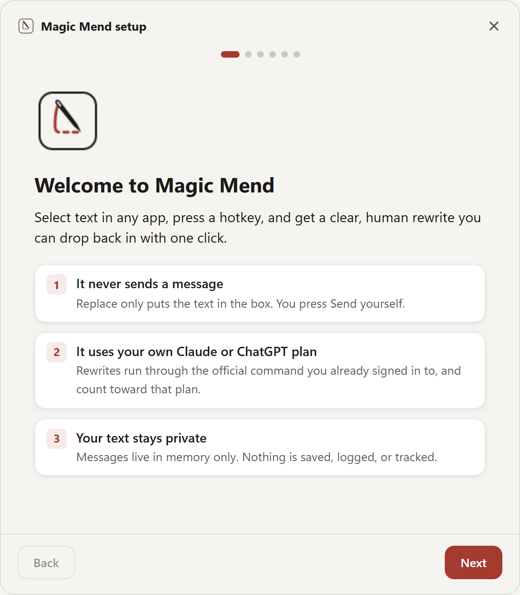
  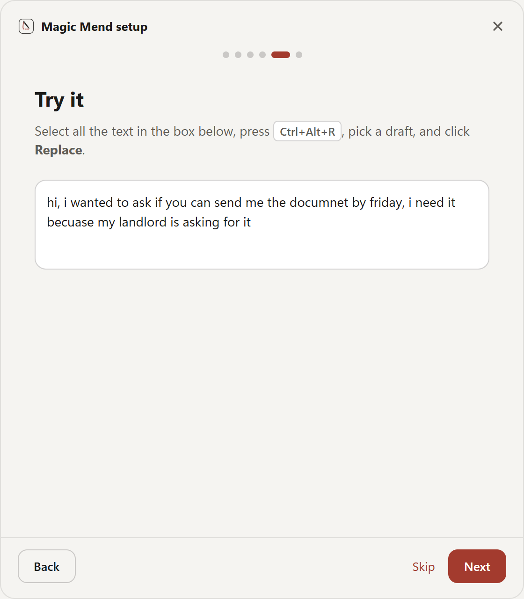
</p>
<p align="center"><em>The setup wizard: a welcome with the three promises and a practice box where you try it for real.</em></p>

<p align="center">
  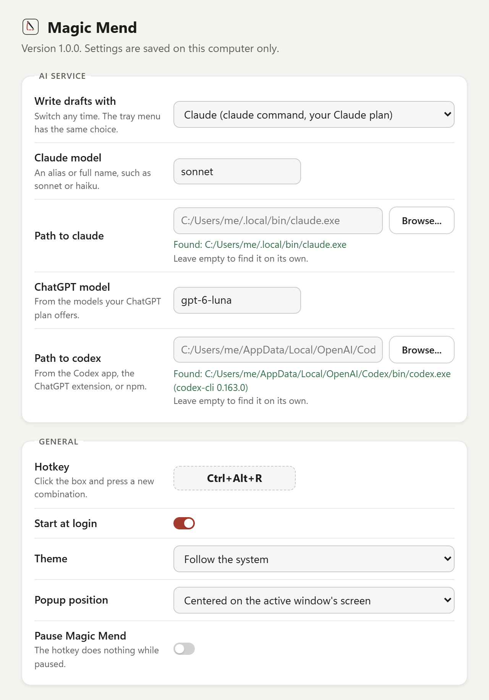
</p>
<p align="center"><em>Settings: hotkey, defaults, model, warm mode, output rules, excluded apps, and channel rules. Saved on your computer only.</em></p>

> Screenshots show the app's own interface with real drafts from Claude Sonnet and, where marked, GPT-6-Luna.

## Performance

Measured on Windows 11 over 20 sample messages per mode, with `claude` 2.1.296 and `codex` 0.163. Full reports: [Claude](docs/M1-timing-report.md) and [ChatGPT](docs/ChatGPT-timing-report.md).

| | Claude Sonnet (default) | GPT-6-Luna (ChatGPT default) | Claude Haiku | GPT-6.1-Sol |
| --- | ---: | ---: | ---: | ---: |
| First words, warm spare (median) | **1.2 s** | **1.25 s** | 2.8 s | 2.7 s |
| Finished drafts, warm spare (median) | **1.6 s** | **1.6 s** | 3.1 s | 3.3 s |
| First words, no spare (median) | 1.6 s | 2.5 s | 3.6 s | 3.7 s |
| Drafts free of contractions and em dashes | 45 of 45 | 23 of 23 | 45 of 45 | 23 of 23 |
| *"i has send the payment"* with Fix errors only | *"I sent the payment"* | *"I sent the payment"* | *"I have sent the payment"* | *"I sent the payment"* |

| Other measurements | |
| --- | ---: |
| Hotkey to visible popup | under 60 ms, before you let go of the keys |
| Memory while idle | app 43 MB, WebView2 about 360 MB, warm `claude` 182 MB |
| Installer size | 1.7 MB |

## Using It

| Control | What it does |
| --- | --- |
| **Tone** | Simple, Respectful, Warm, Casual, Professional, Firm |
| **Length** | Shorter, Same, Fuller |
| **Fix errors only** | Corrects mistakes, keeps your words, one draft |
| **Softer** | Suggestions instead of demands |
| **Less thankful** | At most one thank-you and one apology |
| **Channel** | Text, Email, WhatsApp, LinkedIn |
| **Ask for a change** | A follow-up in your own words. Enter sends it inside the popup |
| **Replace** | Pastes into the original app (mouse only) |
| **Copy** | Leaves the draft on the clipboard (mouse only) |
| **Esc** | Closes the popup and discards the conversation |

**Good to know**
- **Nothing selected?** The popup opens with an empty box. Paste or type, and Copy works.
- **Long text?** Over 4,000 characters, Magic Mend asks before anything goes to Claude or ChatGPT.
- **Tray menu** (right-click the needle icon; on a Mac, click it in the menu bar): Rewrite with Claude, Rewrite with ChatGPT, Settings, Run setup again, Pause, Quit.
- **Rewrites count toward the plan limits** of the service you chose.
- **On a Mac**, the shortcuts are Cmd+C and Cmd+V, and setup asks for the Accessibility permission, which macOS requires for copying the selection and pasting the draft.

## Under the Hood

Magic Mend keeps one official `claude` process running in print mode with streaming JSON in and out, isolated from your personal Claude Code setup:

| Purpose | How |
| --- | --- |
| Stay alive for follow-ups | `-p --input-format stream-json --output-format stream-json --verbose` |
| Stream words as they arrive | `--include-partial-messages` |
| Only the rewrite prompt | `--system-prompt-file` with [prompts/system.txt](prompts/system.txt) |
| No tools at all | `--tools ""` |
| No connectors, skills, or slash commands | `--strict-mcp-config`, `--disable-slash-commands` |
| No personal CLAUDE.md, hooks, plugins, or output styles | `--safe-mode`, `--setting-sources ""`, and an empty working folder |
| No saved transcripts | `--no-session-persistence` |
| No auto-update or extra traffic | `DISABLE_AUTOUPDATER=1`, `CLAUDE_CODE_DISABLE_NONESSENTIAL_TRAFFIC=1` |
| No console window | `CREATE_NO_WINDOW`, plus a job object so the process ends with the app |

ChatGPT runs the same way through OpenAI's official `codex app-server` on your ChatGPT login:

| Purpose | How |
| --- | --- |
| Stay alive for follow-ups, stream words | `codex app-server` over stdio: one thread per popup, `item/agentMessage/delta` events |
| Only the rewrite prompt | `baseInstructions` replaces Codex's own instructions; permissions, environment, apps, and skills blocks off |
| No saved conversations | Ephemeral threads |
| No tools, no personal setup | Read-only sandbox; shell, exec, plugins, apps, skills, memories, hooks, web search, and multi-agent off; `project_doc_max_bytes=0` for AGENTS.md; each of your MCP servers switched off by name |
| Exactly our JSON | An output schema on every turn, low reasoning effort |
| Stale replies stop early | `turn/interrupt` when you change a chip mid-draft |
| Any tool or approval request | Always declined |

Isolation is proven for both: a marker in your user CLAUDE.md or `~/.codex/AGENTS.md` (and a logging hook in your Claude settings) never reaches the engine, while a control run without the isolation settings shows it.

**Capture.** Show the popup at once without taking focus (on Windows), so it is on screen while you let go of the keys. Then save every clipboard format, wait for Ctrl, Alt, Shift, and Win to be released (so the copy shortcut never turns into another shortcut), send Ctrl+C, wait for the clipboard sequence number to move (up to 400 ms), read the text, restore the clipboard, and fill in the popup. If another window came to the front in the meantime, nothing is copied.

**Replace.** Write the draft to the clipboard (hidden from clipboard history), wait until clipboard history and other monitors have let go of it (an app that pastes while they read gets nothing), bring the original window back, wait 80 ms, check that it really is in front, paste, restore the clipboard. When the text box in front is a classic Windows edit box, the paste is a WM_PASTE message and no key is pressed: these boxes try to open the clipboard only once, and some background apps open it whenever Ctrl is pressed, so Ctrl+V sometimes pasted nothing. Every other app gets Ctrl+V, and Magic Mend waits 500 ms for slow apps before restoring the clipboard.

**Reading the stream.** An incremental parser pulls each draft out of the half-finished JSON so words appear as they arrive. Only the reply to the newest request is shown, chip changes wait 300 ms to settle, an invalid reply gets one repair request, and a 30 second timeout offers Retry.

## Build

You need Node 22+, Rust 1.93+, and on Windows the Visual Studio C++ build tools and WebView2 (built into Windows 11).

```bash
git clone https://github.com/mahatab/magic-mend.git
```

```bash
cd magic-mend && npm install && npx tauri build
```

**Windows** produces `src-tauri/target/release/bundle/nsis/Magic Mend_1.1.0_x64-setup.exe`.
**macOS** run `npx tauri build --target universal-apple-darwin --bundles app,dmg` (add both Rust Apple targets first) to produce `Magic Mend.app` and a `.dmg`. On first run the wizard asks for the Accessibility permission, which macOS requires for copying the selection and pasting the draft.

**Releases.** The Windows installer is built locally. The signed and notarized Mac `.dmg` comes from the [Release macOS](.github/workflows/release-mac.yml) workflow, which runs on every `v*` tag (or by hand with a tag) and attaches the `.dmg` to that release. It needs six repository secrets for the Developer ID certificate and Apple notarization; the workflow file lists them.

For development: `npm run dev` serves the popup with a built-in fake backend at `http://localhost:1420/?mock` (add `&email`, `&empty`, `&long`, `&error`, `&fix`, or `&dark`).

## Testing

| Suite | Command | Result | What it covers |
| --- | --- | :---: | --- |
| Rust unit tests | `cd src-tauri && cargo test --lib` | 53 pass | Output checker, request and reply parsing, streaming extraction, draft flow (stale replies, fix round, JSON repair, timeout), channel rules, excluded apps, settings, hotkeys |
| UI unit tests | `npm test` | 20 pass | Popup logic, Replace button states, hotkey capture, and a scan of every source file, comment, and doc for contractions and em dashes |
| Windows end to end | see below | 22 pass, 1 intermittent | The real app, real clipboard, and real key presses against a test window, with a fake `claude` and a fake `codex`, including switching between them |
| Live harness | `mm-harness timing`, `quality`, `isolation` (add `--provider chatgpt`) | pass | Timings, output rules over 159 live runs across both services, facts, follow-ups, setup isolation |
| Accessibility | axe-core | 0 violations | Popup (light and dark), wizard, settings |
| CI | GitHub Actions | passing | Windows tests and lints on every push, a macOS build and test run, and a signed release build verified with `codesign`, `spctl` (Notarized Developer ID), and `stapler` |

The end-to-end suite proves the hard rules on a real desktop: text replaced and Ctrl+Z restores it, the clipboard comes back with every format, no Enter ever reaches the app underneath, terminals are skipped, the warm spare is replaced after each session, and every failure shows a plain message. To run it:

```bash
npx tauri build --debug --no-bundle
```

```bash
cd src-tauri && cargo build --features test-tools --bin mm-testpad --bin mm-fakeclaude --bin mm-fakecodex
```

```bash
node tests/e2e/run.mjs
```

It takes over the keyboard for about six minutes. Results by milestone are in [docs/test-results](docs/test-results).

## Architecture

```
magic-mend/
├── src-tauri/src/
│   ├── app.rs              Tray, hotkey, popup, setup wizard, settings window, engine thread
│   ├── engine.rs           Engine interface, providers, the claude engine, error types
│   ├── codex_engine.rs     The ChatGPT engine: codex app-server protocol and isolation
│   ├── codex_path.rs       Finds the newest official codex, sign-in, MCP names, models
│   ├── engine_manager.rs   Warm spare lifecycle: take, respawn, recycle after idle or sleep
│   ├── drafts.rs           Which reply is current, the fix round, JSON repair, timeout
│   ├── checker.rs          Contraction and em dash check, local em dash repair
│   ├── protocol.rs         Request and reply JSON, incremental draft extraction
│   ├── selection.rs        Capture with full clipboard save and restore
│   ├── actions.rs          Replace and Copy
│   ├── channel.rs          Channel rules and excluded apps
│   ├── settings.rs         Settings file and setup progress
│   ├── hotkey.rs           Hotkey parsing, AltGr and conflict warnings
│   ├── platform/           windows.rs (Win32), macos.rs (AppKit, CoreGraphics, Accessibility)
│   └── bin/                Harness, test window, fake claude, fake codex (tests only)
├── src/                    Popup, wizard, and settings UI (TypeScript, CSS design tokens)
├── prompts/system.txt      The rewrite prompt
├── tests/                  UI unit tests, 20 sample messages, end-to-end suite
├── .github/workflows/      CI, and the signed and notarized Mac release
└── docs/                   Spec, Claude and ChatGPT timing reports, test results
```

### Tech Stack

| Layer | Technology |
| --- | --- |
| Desktop framework | Tauri 2 (Rust and the system WebView) |
| UI | TypeScript, plain DOM, CSS design tokens |
| Windows | Win32 through `windows-rs`: SendInput, clipboard, DWM, job objects |
| macOS | AppKit pasteboard, CoreGraphics events, Accessibility API, vibrancy |
| Rewrites | The official `claude` command (Claude Code) or `codex app-server` (OpenAI Codex), on your own login |
| Plugins | global-shortcut, autostart, single-instance, dialog, opener |
| Tests | cargo test, Vitest, Node with the DevTools protocol, axe-core |
| Installer | NSIS (current user, starts at login) |

## Documentation

- [Build spec](docs/SPEC.md): the full product spec this app was built from
- [Claude timing report](docs/M1-timing-report.md) and [ChatGPT timing report](docs/ChatGPT-timing-report.md): engine timings and the model decisions
- [Test results](docs/test-results): every acceptance test and its status
- [Build notes](NOTES.md): decisions, deviations, and ideas

## Known Limits

- Replace in WhatsApp, Gmail, Messenger, LinkedIn, and Outlook was checked by design and channel tests; a hands-on pass in each app is still worth doing
- Windows 11 draws 8 px window corners when the acrylic background is on (the design asks for 16 px)
- The macOS build is made, signed, notarized, and tested in CI but has not had a hands-on run yet
- OpenAI labels `codex app-server` experimental; Magic Mend is tested against `codex-cli` 0.163, and a future change may need an update
- GPT-6-Luna follows the repeated-word rule less reliably than Claude (about one draft in four on the move-in example)
- The Windows installer is not code signed, so SmartScreen may ask you to confirm the first run

## License

MIT. See [LICENSE](LICENSE) for details.

---

<p align="center">
  <br />
  <sub>Magic Mend, or MM, a nod to M² Labs.</sub>
</p>
